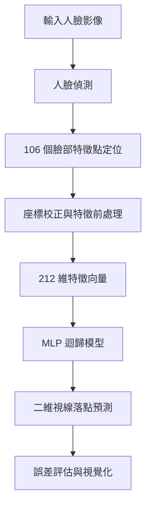
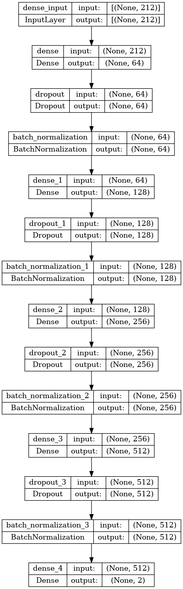

# Gaze Estimation Using Facial Landmarks and Deep Learning

> 基於電腦視覺與多層感知器（MLP）的視線落點預測研究專題。  
> A gaze-point estimation project using facial landmarks, camera calibration, and neural-network regression.

##  專案介紹

本專案以**非接觸式視線落點預測（Gaze Estimation）**為研究主題，透過影像處理與深度學習技術，建立由人臉影像到視線座標的分析流程。系統先偵測人臉並擷取臉部關鍵特徵點，再結合相機校正與座標轉換，將特徵輸入多層感知器（Multilayer Perceptron, MLP），預測使用者的視線落點。

專案使用 **MPIIFaceGaze** 相關影像及校正資料進行實驗，著重於**電腦視覺、特徵工程、座標處理、機器學習模型訓練與誤差分析**的整合。

##  主要功能

- **人臉偵測（Face Detection）**：從輸入影像定位人臉區域。
- **臉部特徵點擷取（Facial Landmark Detection）**：取得 106 個二維臉部特徵點，形成 212 維座標特徵。
- **相機校正與座標轉換**：利用相機內參、畸變參數及顯示器姿態資訊，處理影像特徵與視線標籤的座標。
- **視線落點預測**：使用 TensorFlow / Keras 建立 MLP 迴歸模型，輸出二維視線座標。
- **模型評估與視覺化**：以 MSE、RMSE 與二維座標距離分析預測誤差，並繪製訓練曲線。
- **延伸實驗模組**：包含支援向量迴歸（SVR）、頭部姿態估測及虹膜定位相關程式。

##  系統流程



本專案採用**關鍵點特徵驅動的迴歸方法**：先從影像中擷取臉部幾何資訊，再交由 MLP 預測座標，而不是將完整原始影像直接輸入最終的 MLP 模型。

##  模型架構

主要模型位於 [`MLPmodel.py`](MLPmodel.py)，輸入為 106 組二維臉部特徵點（共 212 維），輸出為二維視線座標。

| 項目 | 設計 |
| --- | --- |
| 輸入特徵 | 212 維臉部關鍵點座標 |
| 隱藏層 | Dense 64 → 128 → 256 → 512 |
| 活化函數 | LeakyReLU |
| 正規化 | Batch Normalization |
| 輸出層 | Dense 2（線性輸出） |
| 損失函數 | Mean Squared Error（MSE） |
| 評估指標 | Root Mean Squared Error（RMSE） |
| 最終使用的最佳化器 | Adam |



##  使用技術

| 類別 | 技術 |
| --- | --- |
| 程式語言 | Python |
| 影像處理與幾何計算 | OpenCV、NumPy |
| 深度學習 | TensorFlow、Keras |
| 臉部偵測與特徵定位 | MXNet、預訓練人臉模型 |
| 機器學習延伸實驗 | SVR、LIBSVM、scikit-learn |
| 資料分析與視覺化 | Pandas、Matplotlib |
| 資料集 | MPIIFaceGaze |

##  專案結構

```text
Senior_Project/
├── service/             # 人臉偵測、特徵點、頭部姿態、虹膜定位模組
├── preprocess.py        # 另一種特徵點資料前處理流程
├── pre_tset_data.py     # MPIIFaceGaze 人臉特徵點資料擷取
├── LoadData.py          # CSV 載入、相機校正、標籤座標處理
├── MLPmodel.py          # MLP 建模、訓練及預測誤差評估
├── svr.py               # SVR 迴歸實驗程式
├── readscreensize.py    # 顯示器姿態資料讀取與轉換
├── plot_utlis.py        # 訓練曲線及預測結果繪圖
├── Library.py           # 共用函式庫匯入
├── MLP.png              # MLP 模型結構圖
└── README.md
```

##  執行方式

### 1. 取得原始碼

```bash
git clone https://github.com/lazyyy18/Senior_Project.git
cd Senior_Project
```

### 2. 準備環境與資料

本專案為研究型程式碼，**尚未提供可直接重現所有實驗的完整環境設定**。執行前需要依程式實際使用的版本安裝相關套件，並準備：

- MPIIFaceGaze 資料集及其相機／螢幕校正資訊。
- 人臉偵測與特徵點定位所需的預訓練權重（程式參照 `weights/` 路徑）。
- 模型訓練所需的 CSV 檔案，例如 `68test.csv`、`monitorpose.csv`、`camera.csv`、`distcoeffs.csv`、`screensize.csv`、`testrosol.csv`。
- 繪圖輸出資料夾與符合本機環境的資料路徑。

### 3. 研究流程參考

依照資料與模型權重準備情況，可使用下列腳本進行處理：

```bash
# 擷取顯示器姿態校正資料
python readscreensize.py

# 從影像擷取臉部特徵點
python pre_tset_data.py

# 使用已準備好的特徵與標籤訓練 MLP
python MLPmodel.py
```

> **注意**：上述為各腳本的使用順序示意，並非保證可直接執行的完整安裝流程。原始碼含固定路徑及外部檔案依賴，需先完成資料配置與環境相容性調整。

##  模型評估

程式以預測座標與真實座標之間的差異評估模型，包含 MSE、RMSE，以及每筆資料的二維歐氏距離誤差：

\[
e_i = \sqrt{(\hat{x}_i-x_i)^2 + (\hat{y}_i-y_i)^2}
\]


